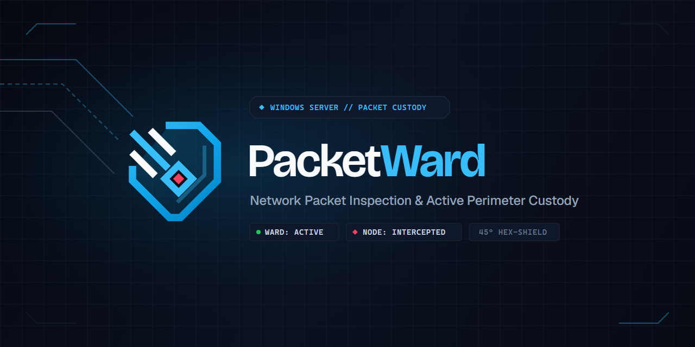

<p align="center">
  
</p>

# PacketWard

**Open-source network defense and diagnostics for Windows Server VPS / RDP machines.**

PacketWard is built by [XeroHost](https://xerohost.net) to help a non-expert answer, in minutes:
*Am I being attacked? From where? How much? Is it my network or the route? Block it.*
It is useful to anyone running a Windows server, not only XeroHost customers.

> **Status: pre-alpha.** The project is under active development and has no release yet.
> Progress is tracked milestone by milestone in [`docs/ROADMAP.md`](docs/ROADMAP.md).
> Nothing below is available to install today.

## What it is meant to do

- **See** live inbound traffic and attacks: bandwidth, top talkers, protocols, countries.
- **Detect** SYN/UDP/ICMP floods, port scans, connection floods and RDP brute force.
- **Block** with the Windows Firewall, manually or through the *Guardian* auto-blocker.
- **Diagnose** the network: ping, MTR, DNS, port checks and a speed test.
- **Collect evidence** as a local support bundle (packet capture + summary) to attach to a support ticket.

### Guardian is conservative by design

This tool can lock people out of their own servers, so the defaults are cautious:

- A fresh install starts in **Monitor** (dry-run) mode. Blocking is something you turn on.
- It never blocks the current RDP clients, your allowlist, the default gateway, your DNS servers or loopback.
- Every automatic block expires, is written to an audit log and can be undone with `pwctl unblock --all`.
- All firewall rules live in the `PacketWard` rule group and are removed on uninstall.

### What it cannot do

PacketWard runs on the host. It **cannot stop a volumetric DDoS** that saturates your VPS uplink: once the
pipe is full, only upstream mitigation (your provider's DDoS protection) helps. The app tells you when
inbound traffic gets close to your link capacity.

It is not an IDS with deep payload inspection, an antivirus or a VPN.

## How it works

| Piece | Role |
|---|---|
| `packetward-agent` | Windows service. Owns every privileged task and keeps protecting when you disconnect from RDP or close the UI. |
| `PacketWard` (desktop) | Tauri 2 + Vue 3 app. Runs unelevated, lives in the tray and shows notifications. Requires the agent. |
| `pwctl` | Basic CLI for emergency recovery and scripting. |

The agent is required: there is no portable mode. Details are in [`docs/ARCHITECTURE.md`](docs/ARCHITECTURE.md).

## Requirements

- Windows Server 2019/2022/2025, or Windows 10 1809+ / Windows 11 (x64).
- [WebView2 Runtime](https://developer.microsoft.com/microsoft-edge/webview2/) for the desktop app. Many Windows
  Server images do not ship it.
- Optional: [Npcap](https://npcap.com) for full-fidelity packet capture. Npcap is **not bundled**, because its
  free license forbids redistribution. Without it PacketWard falls back to a built-in raw-socket backend.

## Unsigned releases and SmartScreen

Releases are **not code-signed yet**. When you run the installer, Windows SmartScreen may show
*"Windows protected your PC"*. If you downloaded it from this repository's Releases page, choose
**More info → Run anyway**. Release artifacts will be signed as soon as a certificate is available.

## Privacy

No telemetry. PacketWard only makes network requests for: update checks, speed-test servers, the GeoIP
database download, blocklist refreshes you enabled, and AbuseIPDB lookups **only if you configured your own
key**. Support bundles are written locally and never uploaded. API keys are stored in Windows Credential Manager.

## Building from source

Requires the pinned Rust toolchain (see `rust-toolchain.toml`), Node.js 24 and pnpm.

```powershell
cargo fmt --all
cargo clippy --workspace --all-targets -- -D warnings
cargo test --workspace

cd apps\desktop
pnpm install
pnpm lint; pnpm typecheck; pnpm test
pnpm tauri dev
```

See [`CONTRIBUTING.md`](CONTRIBUTING.md) for conventions. The desktop app needs the agent service to be
installed and running; for development you can run the agent in a terminal instead.

## Credits

- GeoIP lookups will use [DB-IP](https://db-ip.com) Lite databases (CC BY 4.0).
- Fonts: Bricolage Grotesque, Geist and JetBrains Mono (SIL OFL).
- UI components based on [shadcn-vue](https://www.shadcn-vue.com) (MIT).

## License

[GPL-3.0-or-later](LICENSE). Forks must stay open.

---

<p align="center">PacketWard is made by <a href="https://xerohost.net">XeroHost</a>.</p>
